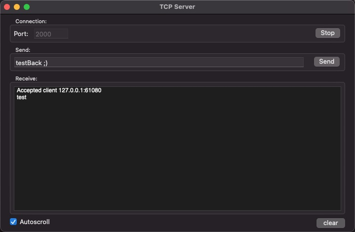

# Acceptor – Simple TCP Server GUI

A simple SwiftUI app (macOS, iPhone, iPad) to host TCP servers and send/receive text based messages. JSON payloads are shown as a tree, with a raw/processed toggle and text export.

  

Also see [Initiator (TCP Client)](https://github.com/voelkerb/TCPClient).